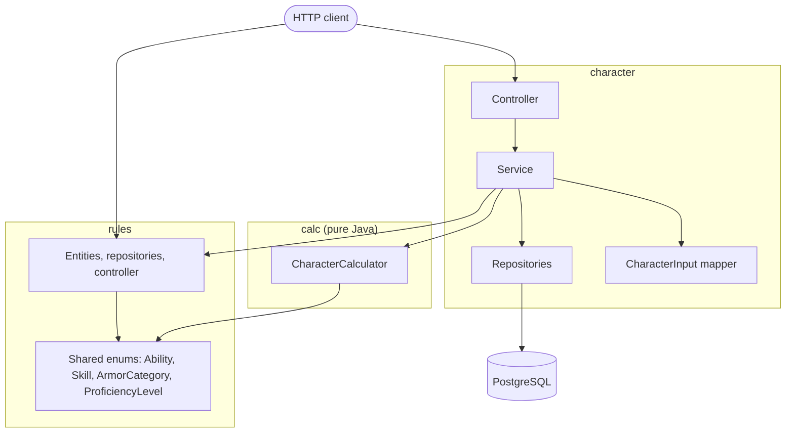

# D&D 2024 Character Manager API


A REST API for creating and viewing Dungeons & Dragons (2024 rules) characters.
You choose a class, species, background and ability scores; the API validates the
choices against the rules data and returns a computed character sheet: ability
modifiers, skills, saving throws, proficiency bonus, HP, AC and passive scores.

**Stack:** Java 21, Spring Boot 4, Spring Data JPA, PostgreSQL, Flyway,
MapStruct, springdoc (Swagger UI), JUnit 5, Mockito, AssertJ, Testcontainers.

## Running it

Prerequisites: Java 21, Maven, and Docker running.

```bash
mvn spring-boot:run
```

PostgreSQL starts automatically through Spring Boot's Docker Compose support.
Open **http://localhost:2072/swagger-ui.html** to try the endpoints.
Two demo characters are created on first launch (disable with `app.demo-data.enabled: false`).

Run the tests (Docker must be running, the integration tests start a real PostgreSQL):

```bash
mvn verify
```

## Endpoints

| Method | Path                 | Description                                              |
|--------|----------------------|----------------------------------------------------------|
| GET    | `/rules/classes`     | Classes (hit die, saving throw proficiencies)            |
| GET    | `/rules/species`     | Species (speed, sizes)                                   |
| GET    | `/rules/backgrounds` | Backgrounds (ability options, skills)                    |
| GET    | `/rules/armor`       | Armor and shields                                        |
| POST   | `/characters`        | Create a character, returns `201` and the computed sheet |
| GET    | `/characters/{id}`   | Character sheet                                          |
| GET    | `/characters`        | Paginated list (`?page=0&size=20&sort=name`)             |
| DELETE | `/characters/{id}`   | Delete a character                                       |

### Example

<details>
<summary><code>POST /characters</code></summary>

```json
{
  "name": "Tom",
  "level": 5,
  "baseAbilityScores": {
    "strength": 15,
    "dexterity": 14,
    "constitution": 13,
    "intelligence": 12,
    "wisdom": 10,
    "charisma": 8
  },
  "classId": "fighter",
  "speciesId": "human",
  "backgroundId": "soldier",
  "backgroundAbilityBonuses": {
    "STR": 2,
    "CON": 1
  },
  "armorId": "chain-mail",
  "classSkills": ["PERCEPTION", "ACROBATICS"],
  "backgroundTool": "DICE"
}
```
</details>

<details>
<summary><b>Response</b></summary>

```json
{
  "id": 3,
  "name": "Tom",
  "level": 5,
  "speciesName": "Human",
  "className": "Fighter",
  "backgroundName": "Soldier",
  "calculatedStats": {
    "proficiencyBonus": 3,
    "abilities": {
      "STR": {
        "base": 15,
        "bonus": 2,
        "total": 17,
        "modifier": 3
      },
      "DEX": {
        "base": 14,
        "bonus": 0,
        "total": 14,
        "modifier": 2
      },
      "CON": {
        "base": 13,
        "bonus": 1,
        "total": 14,
        "modifier": 2
      },
      "INT": {
        "base": 12,
        "bonus": 0,
        "total": 12,
        "modifier": 1
      },
      "WIS": {
        "base": 10,
        "bonus": 0,
        "total": 10,
        "modifier": 0
      },
      "CHA": {
        "base": 8,
        "bonus": 0,
        "total": 8,
        "modifier": -1
      }
    },
    "skills": {
      "ATHLETICS": 6,
      "ACROBATICS": 5,
      "SLEIGHT_OF_HAND": 2,
      "STEALTH": 2,
      "ARCANA": 1,
      "HISTORY": 1,
      "INVESTIGATION": 1,
      "NATURE": 1,
      "RELIGION": 1,
      "ANIMAL_HANDLING": 0,
      "INSIGHT": 0,
      "MEDICINE": 0,
      "PERCEPTION": 3,
      "SURVIVAL": 0,
      "DECEPTION": -1,
      "INTIMIDATION": 2,
      "PERFORMANCE": -1,
      "PERSUASION": -1
    },
    "savingThrows": {
      "STR": 6,
      "DEX": 2,
      "CON": 5,
      "INT": 1,
      "WIS": 0,
      "CHA": -1
    },
    "maxHp": 44,
    "armorClass": 16,
    "initiative": 2,
    "passivePerception": 13,
    "passiveInsight": 10,
    "passiveInvestigation": 11,
    "toolProficiencies": ["DICE"]
  }
}
```
</details>

Errors use the standard `ProblemDetail` format. Invalid input returns `400` with
per-field messages; unknown ids return `404`.

## Architecture



Dependency rule: `calc` depends only on the shared enums, never on entities, JPA or Spring. The `character`
layer turns a `PlayerCharacter` into a plain `CharacterInput` record before calling the
calculator. The `config`, `demo` and `exception` packages hold Swagger setup, demo data and
the global error handler.

## Rules data

Rules content is a deliberately small subset for now:

- **Classes:** Fighter, Wizard, Rogue
- **Species:** Human, Elf, Dwarf
- **Backgrounds:** Soldier, Acolyte, Criminal
- **Armor:** the full 2024 list, plus the shield

The data is based on the SRD 5.2.1 (see [License and attribution](#license-and-attribution)).
Only the mechanical values the app uses are stored (hit dice, armor class, DEX caps,
proficiencies); any descriptive text is summarized in my own words.

Rules live in Flyway migrations (`V2`, `V3`, `V7`), so adding content means adding a new
migration with `insert` statements. Applied migrations are never edited. Corrections go in a
new migration. Every row has a stable slug id (`fighter`, `chain-mail`) and a `source` column.

## Design decisions

**Starting over.** My first plan was a feature hierarchy: a parent `Feature` class with child
types like "grants a resource" or "grants a spell", for everything a background, feat, species
or class could give a character. It got tangled before I had a single working endpoint. I threw
it away and rebuilt the project as a thin skeleton: create a character, get a computed sheet.
Features, spells and subclasses come back later, one slice at a time.

**Store choices, compute everything else.** The database holds only what the player decided:
base ability scores, class, background, armor, and the bonus and skill rows that came from
those choices. Modifiers, skills, etc. are calculated on every read, so a stored
total can never disagree with its sources. 

**A calculator with no framework in it.** The formulas are static functions in `calc` that
take a plain `CharacterInput` record and return numbers. The `calculator` package converts a
`PlayerCharacter` into that record first. This keeps the part with the most rules and most
possible bugs, testable without Spring or database.

**Rules in the database.** Classes, species, backgrounds and armor
are rows with stable slug ids.

**Separate grants.** Ability bonuses and skill proficiencies are stored in separate tables. 
A single "grant" table would look neater, but the two behave differently: bonuses add up and 
are capped at 20, while proficiencies take the highest level and never stack.

**Validation in two places.** Bean Validation checks the shape of a request (ranges, blanks,
required fields). Anything that needs the database, such as whether the ids exist, whether the
background offers those abilities, or whether the chosen skills are on the class list, is
checked in the service.

## Roadmap

Planned work and known limitations are tracked as
[GitHub issues](https://github.com/nemcica/dnd-character-app/issues) and on the
[project board](https://github.com/users/nemcica/projects/3).

The main gaps right now: no spells or class features yet, no multiclassing, no update
endpoint, and no authentication.

## License and attribution

This work includes material from the System Reference Document 5.2.1 (“SRD 5.2.1”) by Wizards of the
Coast LLC, available at https://www.dndbeyond.com/srd. The SRD 5.2.1 is licensed under the Creative
Commons Attribution 4.0 International License, available at https://creativecommons.org/licenses/by/4.0/legalcode.
