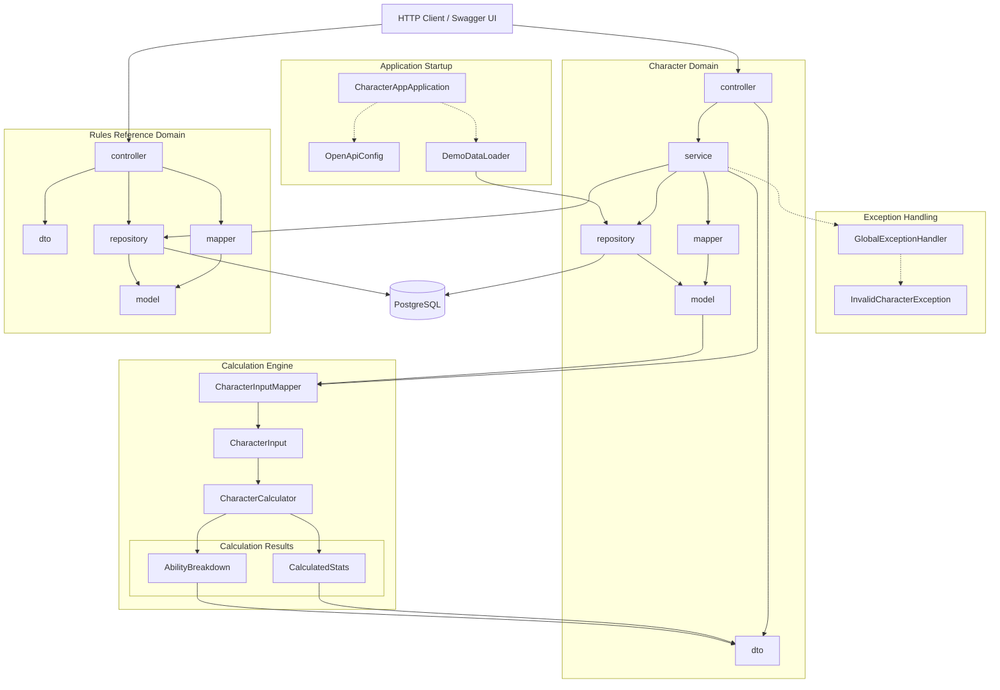

# D&D 2024 Character Manager API


A REST API for creating and viewing Dungeons & Dragons (2024 rules) characters.
You choose a class, species, background and ability scores; the API validates the
choices against the rules data and returns a computed character sheet: ability
modifiers, skills, saving throws, proficiency bonus, HP, AC and passive scores.

**Stack:** Java 21, Spring Boot 4, Spring Data JPA, PostgreSQL, Flyway,
MapStruct, springdoc (Swagger UI), JUnit 5, Mockito, AssertJ, Testcontainers.

## Running it

Prerequisites: Java 21, Maven, and Docker running.

```bash
mvn spring-boot:run
```

PostgreSQL starts automatically through Spring Boot's Docker Compose support.
Open **http://localhost:2072/swagger-ui.html** to try the endpoints.
Two demo characters are created on first launch (disable with `app.demo-data.enabled: false`).

Run the tests (Docker must be running, the integration tests start a real PostgreSQL):

```bash
mvn verify
```

## Endpoints

| Method | Path                 | Description                                              |
|--------|----------------------|----------------------------------------------------------|
| GET    | `/rules/classes`     | Classes (hit die, saving throw proficiencies)            |
| GET    | `/rules/species`     | Species (speed, sizes)                                   |
| GET    | `/rules/backgrounds` | Backgrounds (ability options, skills)                    |
| GET    | `/rules/armor`       | Armor and shields                                        |
| POST   | `/characters`        | Create a character, returns `201` and the computed sheet |
| GET    | `/characters/{id}`   | Character sheet                                          |
| GET    | `/characters`        | Paginated list (`?page=0&size=20&sort=name`)             |
| DELETE | `/characters/{id}`   | Delete a character                                       |

### Example

<details>
<summary><code>POST /characters</code></summary>

```json
{
  "name": "Tom",
  "level": 5,
  "baseAbilityScores": {
    "strength": 15,
    "dexterity": 14,
    "constitution": 13,
    "intelligence": 12,
    "wisdom": 10,
    "charisma": 8
  },
  "classId": "fighter",
  "speciesId": "human",
  "backgroundId": "soldier",
  "backgroundAbilityBonuses": {
    "STR": 2,
    "CON": 1
  },
  "armorId": "chain-mail",
  "classSkills": ["PERCEPTION", "ACROBATICS"]
}
```
</details>

<details>
<summary><b>Response</b></summary>

```json
{
  "id": 3,
  "name": "Tom",
  "level": 5,
  "speciesName": "Human",
  "className": "Fighter",
  "backgroundName": "Soldier",
  "calculatedStats": {
    "proficiencyBonus": 3,
    "abilities": {
      "STR": {
        "base": 15,
        "bonus": 2,
        "total": 17,
        "modifier": 3
      },
      "DEX": {
        "base": 14,
        "bonus": 0,
        "total": 14,
        "modifier": 2
      },
      "CON": {
        "base": 13,
        "bonus": 1,
        "total": 14,
        "modifier": 2
      },
      "INT": {
        "base": 12,
        "bonus": 0,
        "total": 12,
        "modifier": 1
      },
      "WIS": {
        "base": 10,
        "bonus": 0,
        "total": 10,
        "modifier": 0
      },
      "CHA": {
        "base": 8,
        "bonus": 0,
        "total": 8,
        "modifier": -1
      }
    },
    "skills": {
      "ATHLETICS": 6,
      "ACROBATICS": 5,
      "SLEIGHT_OF_HAND": 2,
      "STEALTH": 2,
      "ARCANA": 1,
      "HISTORY": 1,
      "INVESTIGATION": 1,
      "NATURE": 1,
      "RELIGION": 1,
      "ANIMAL_HANDLING": 0,
      "INSIGHT": 0,
      "MEDICINE": 0,
      "PERCEPTION": 3,
      "SURVIVAL": 0,
      "DECEPTION": -1,
      "INTIMIDATION": 2,
      "PERFORMANCE": -1,
      "PERSUASION": -1
    },
    "savingThrows": {
      "STR": 6,
      "DEX": 2,
      "CON": 5,
      "INT": 1,
      "WIS": 0,
      "CHA": -1
    },
    "maxHp": 44,
    "armorClass": 16,
    "initiative": 2,
    "passivePerception": 13,
    "passiveInsight": 10,
    "passiveInvestigation": 11
  }
}
```
</details>

Errors use the standard `ProblemDetail` format. Invalid input returns `400` with
per-field messages; unknown ids return `404`.

## Architecture





Dependency rule: `rules` depends on nothing, `calc` depends only on the shared rules enums
(never on entities, JPA or Spring), and `character` depends on both. The `calculator` layer
converts a `PlayerCharacter` into a plain `CharacterInput` record before calling the calculator.


## Rules data

Rules content is a deliberately small subset for now:

- **Classes:** Fighter, Wizard, Rogue
- **Species:** Human, Elf, Dwarf
- **Backgrounds:** Soldier, Acolyte, Criminal
- **Armor:** the full 2024 list, plus the shield

The data is based on the SRD 5.2.1 (see [License and attribution](#license-and-attribution)).
Only the mechanical values the app uses are stored (hit dice, armor class, DEX caps,
proficiencies); any descriptive text is summarized in my own words.

Rules live in Flyway migrations (`V2`, `V3`, `V7`), so adding content means adding a new
migration with `insert` statements. Applied migrations are never edited. Corrections go in a
new migration. Every row has a stable slug id (`fighter`, `chain-mail`) and a `source` column.

## Design decisions

- **Totals are computed, never stored.** The database holds base ability scores and a
  list of bonus rows (each with a source such as `BACKGROUND:soldier`). Totals,
  modifiers, skills, HP and AC are calculated on every read, so changing a
  background or removing a bonus can't leave stale numbers behind.
- **A pure, unit-tested calculator.** All formulas are static functions in `calc`,
  tested with edge cases (floor division for negative modifiers, DEX caps by armor
  type, level thresholds for the proficiency bonus, HP with a negative CON modifier).
- **Entities and DTOs are separate.** The API shape can change without touching the
  schema, and lazy relations never leak into JSON.
- **Rules data lives in the database with stable slug ids** (`fighter`, `soldier`),
  so adding a book means adding rows, not changing code. Each row has a `source` column.
- **Sparse proficiency storage.** Only proficiencies a character actually has are stored.
  Background skills are derived from the background; player-chosen skills are stored
  as grants. When two sources overlap, the highest level wins.
- **Schema is versioned with Flyway**, and Hibernate only validates it.
- **Validation in two layers.** Bean Validation checks request shape (ranges, blanks);
  the service checks rules that need the database (ids exist, armor and shield are in
  the right slots, background bonuses are legal).
- **Tests at every layer.** Unit tests for formulas and mappers, Mockito tests for
  the service, `MockMvc` tests for the controller, repository tests and an end-to-end
  test against a real PostgreSQL via Testcontainers.

## Roadmap

Planned work and known limitations are tracked as
[GitHub issues](https://github.com/nemcica/dnd-character-app/issues) and on the
[project board](https://github.com/users/nemcica/projects/3).

The main gaps right now: no spells or class features yet, no multiclassing, no update
endpoint, and no authentication.

## License and attribution

This work includes material from the System Reference Document 5.2.1 (“SRD 5.2.1”) by Wizards of the
Coast LLC, available at https://www.dndbeyond.com/srd. The SRD 5.2.1 is licensed under the Creative
Commons Attribution 4.0 International License, available at https://creativecommons.org/licenses/by/4.0/legalcode.
